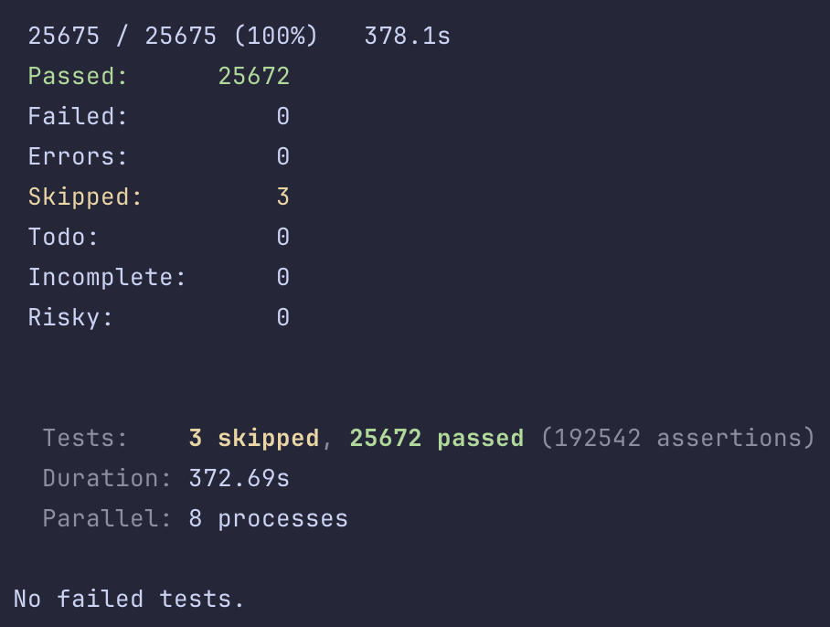
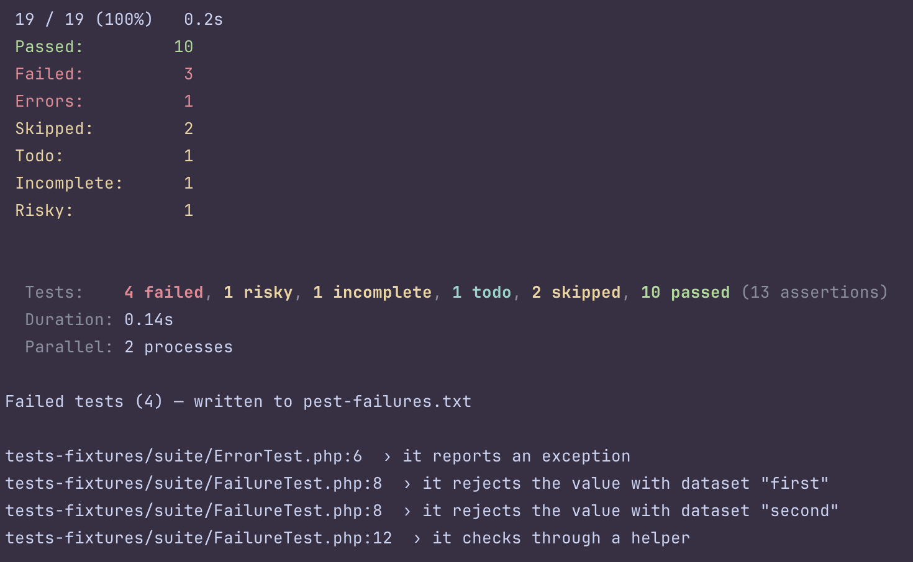
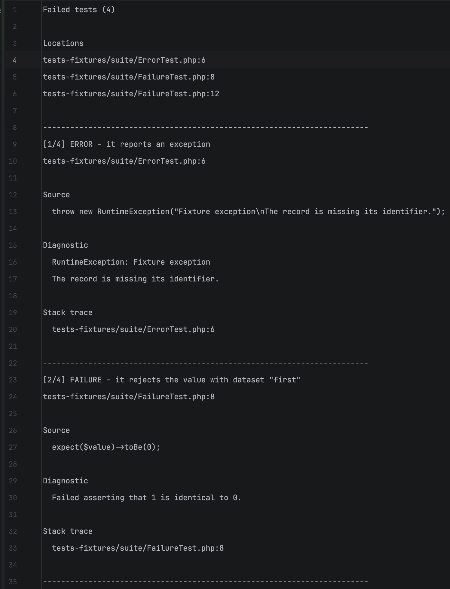

# Pest Progress

Pest Progress is designed for projects with large test suites. A live counter keeps terminal output compact by showing completed tests, elapsed time, and totals by outcome. To debug a failure, find the test by name and `file:line` in the final summary, then open the plain-text report for the diagnostic message and stack trace.

| Pest with `--compact` | Pest with `--progress` |
| --- | --- |
|  |  |

## Installation

Install the plugin as a development dependency. It supports Pest 2.x through 5.x and requires a PHP version supported by your Pest release.

```sh
composer require --dev vetarsonr/pest-plugin-progress
```

## Usage

Use `--progress` to replace Pest's per-test output with the counter. The `--compact` flag is optional.

```sh
./vendor/bin/pest --progress
./vendor/bin/pest --parallel --progress
```


The counter is opt-in. Set `PEST_PROGRESS=1` to enable it by default. In CI and redirected output, progress appears as plain text. On native Windows, the plugin prints the final counts.

If a parallel worker cannot load a data provider, PHPUnit can report one discovery error for several missing test cases. The counter shows how many discovered tests produced a result. The failure report identifies the test that owns the provider.

## Failed tests in the terminal

Pest Progress groups failures and errors in one list below Pest's final summary. Each row shows the file, line, and test name. Dataset names distinguish cases that fail on the same line.



## Failure report

With the counter enabled, a test failure or error produces **`tests/pest-failures.txt`** in your project. If you use `--test-directory=spec`, the default becomes `spec/pest-failures.txt`. Both paths are relative to the project root, including when you start Pest from a subdirectory.

The report starts with an index of `file:line` locations. Each failed test or dataset has its own entry with the available source line, assertion or exception message, diff, and stack trace. A passing run with the plugin enabled removes the previous report at the selected path.



Add `/tests/pest-failures.txt` to your project's `.gitignore` to keep generated reports out of commits. A custom report path can be absolute or relative to your working directory. Use `--failures-file=pest-failures.txt` for the filename shown in the terminal summary.

```sh
./vendor/bin/pest --progress --failures-file=build/pest-failures.txt
```

## Options

Command-line options take precedence over environment settings.

| Option | Environment setting | Effect |
| --- | --- | --- |
| `--progress` | `PEST_PROGRESS=1` | Enable the counter and failure report. |
| `--no-progress-counter` | `PEST_PROGRESS=0` | Use Pest's standard output for this run. |
| `--failures-file=PATH` | `PEST_FAILURES_FILE=PATH` | Write the report to a relative or absolute path. |
| `--no-failures-file` | `PEST_FAILURES_FILE=0` | Print the failure list in the terminal only. |
| `--failures-verbosity=N` | `PEST_FAILURES_VERBOSITY=N` | `1` lists each location once. `2` lists each failing test by location and name, including its dataset (default). |
| `--show-failure-details` | `PEST_SHOW_DETAILS=1` | Also show Pest's full failure diagnostics in the terminal. |

## License

[MIT](LICENSE.md)
